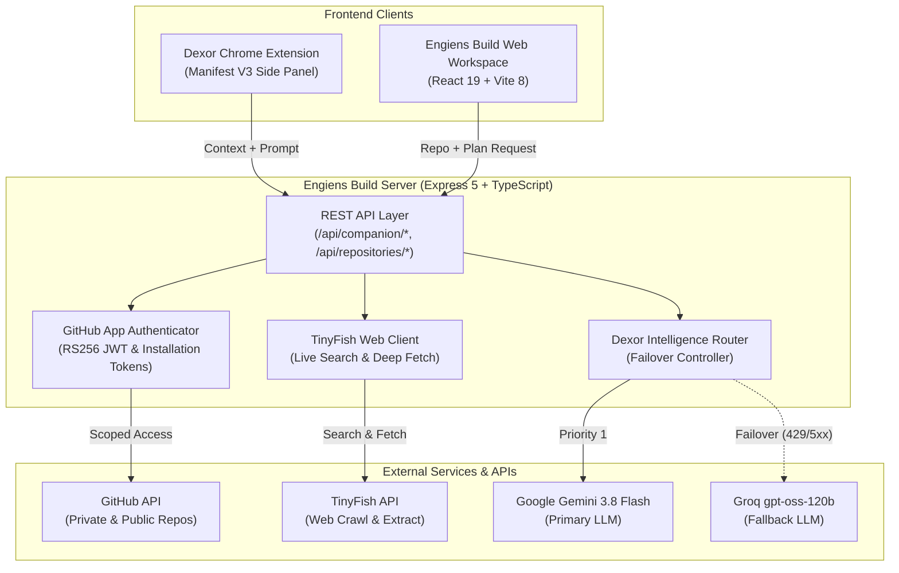
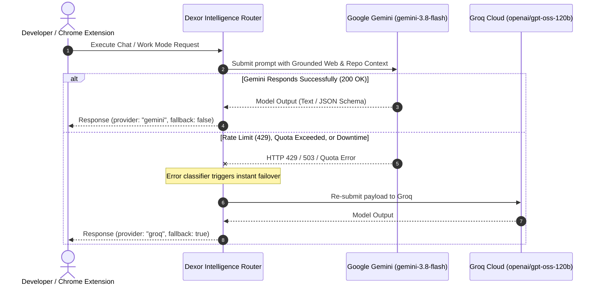
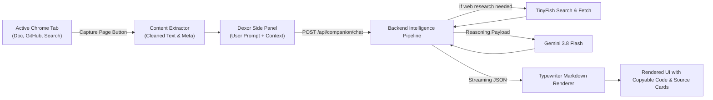

# Engiens Build — Dexor

> **A Web-Aware AI Engineering Teammate**  
> Unifying private GitHub repository context, real-time web intelligence via TinyFish, multi-provider AI reasoning (Gemini 3.8 Flash + Groq fallback), and an in-browser Chrome Side Panel companion.

---

## Overview & Problem Statement

Modern software engineers spend upwards of **40% of their working hours context-switching** between code editors, GitHub PRs and issues, API documentation, Stack Overflow, and external LLM chat windows. Traditional AI coding assistants either:
1. **Lack live web awareness**, relying on stale pre-training weights and hallucinating outdated APIs or breaking changes.
2. **Cannot securely access private enterprise repositories**, requiring risky, broad-permission Personal Access Tokens (PATs).
3. **Trap developers inside an isolated chat tab or IDE window**, detached from the active documentation or web search where engineering questions actually arise.

**Engiens Build** solves this by introducing **Dexor**: an AI engineering teammate that lives simultaneously in a dedicated engineering workspace and right inside Google Chrome as a Manifest V3 Side Panel companion.

Whether you are browsing Google Search for architectural patterns, reading bleeding-edge documentation on GitHub, or refactoring a private repository, Dexor extracts active page context, searches and parses the live web using TinyFish, and generates production-ready engineering plans grounded in real code.

---

## Key Capabilities & Features

### 1. Dexor Chrome Companion (Manifest V3 Side Panel)
- **Always-Present Teammate**: Lives in the native Chrome Side Panel, working alongside you without obstructing page content.
- **On-Demand Webpage Extraction**: With one click, Dexor securely extracts the active tab's metadata, title, URL, headings, and clean text body to ground queries in the exact page you are viewing.
- **ChatGPT-Quality Conversational Experience**:
  - Smooth dynamic chunk-scaling typewriter streaming effect.
  - Complete GitHub-Flavored Markdown (GFM) rendering with bolding, lists, blockquotes, and tables.
  - Syntax-highlighted code blocks with one-click clipboard copy and detected language headers.
  - Clickable TinyFish citation cards linking directly to discovered online sources.

### 2. Dual Companion Modes
- **Chat Mode**: Fast, interactive conversational technical guidance, debugging assistance, architecture critique, and code reviews.
- **Work Mode**: Structured, deep engineering synthesis that produces:
  - High-level recommendation and architectural justification.
  - File-by-file patch plan with concrete additions, modifications, and deletions.
  - Step-by-step phased implementation roadmap.
  - Technical risks, tradeoffs, and verification checklists.

### 3. Native GitHub App Authentication (Private Repositories)
- Full support for **GitHub App ID, Installation ID, and RSA Private Key (`.pem`)** generating ephemeral 1-hour RS256 installation access tokens.
- Secure, token-free read-only access to authorized private repositories (e.g. `ShopKart`).
- Backward-compatible fallback to `GITHUB_TOKEN` for public repositories or personal environments.
- High-efficiency recursive tree inspection, branch tracking, and file blob fetching.

### 4. Real-Time Web Intelligence via TinyFish
- Integrated **TinyFish Search and Fetch APIs**.
- When questions require current external documentation, Dexor automatically initiates live web searches.
- Deep-fetches and parses full target web pages to inject authentic, verified technical context into the reasoning prompt.

### 5. Dexor Intelligence Router (Gemini-First + Groq Fallback)
- **Primary Reasoner**: Google Gemini (`gemini-3.8-flash` via `@google/genai`).
- **Resilient Fallback**: Groq Cloud (`openai/gpt-oss-120b` via Groq OpenAI-compatible API).
- **Automated Fault Tolerance**: Intelligent error classification catches 429 rate limits, quota limits, model outages, and timeouts, silently routing to the fallback provider with zero disruption to the user.
- Transparent telemetry reports the active provider and fallback status on every request.

---

## Architecture & System Flow

### System Architecture



---

### Intelligence Router & Fallback Flow



---

### Browser Companion Workflow



---

## Directory Structure

```text
Engiens-Build/
├── client/                     # Web workspace frontend (React 19, Tailwind 4)
│   ├── src/
│   │   ├── components/         # Dexor companion panel, repo inspector, diff viewer
│   │   ├── App.tsx             # Main workspace application shell
│   │   └── main.tsx            # Vite root entry
│   ├── index.html
│   ├── tsconfig.json
│   └── vite.config.ts
├── extension/                  # Dexor Chrome Companion (Manifest V3)
│   ├── dist/                   # Ready-to-load unpacked Chrome extension
│   ├── public/icons/           # 16px, 48px, 128px companion icons
│   ├── src/
│   │   ├── components/         # MarkdownRenderer, CodeBlock, ChatMessage, SourceCard
│   │   ├── hooks/              # useTypewriter dynamic streaming hook
│   │   ├── content.ts          # Page text & metadata extractor script
│   │   ├── service-worker.ts   # Side Panel opener & message bridge
│   │   └── SidePanel.tsx       # Main companion side panel user interface
│   ├── manifest.json           # Chrome MV3 manifest (sidePanel, activeTab, scripting)
│   ├── sidepanel.html          # HTML entry point for side panel
│   ├── tsconfig.json
│   └── vite.config.ts
├── server/                     # Backend API & Intelligence Router (Express 5, Node 22)
│   ├── src/
│   │   ├── services/
│   │   │   ├── companionService.ts     # Chat & Work mode orchestration
│   │   │   ├── githubAppAuth.ts        # GitHub App RS256 token manager
│   │   │   ├── githubService.ts        # Tree & file repository inspection
│   │   │   ├── intelligenceRouter.ts   # Multi-provider Gemini/Groq fallback router
│   │   │   └── tinyfishService.ts      # TinyFish search & fetch client
│   │   ├── app.ts              # Express application configuration
│   │   └── index.ts            # Server entrypoint and graceful shutdown
│   ├── test/                   # Vitest unit & integration test suites
│   └── tsconfig.json
├── shared/                     # Shared TypeScript schemas and contracts
│   └── contract.ts             # Strongly-typed API payload schemas
├── .env.example                # Template for environment configuration
├── .gitignore                  # Strict secret and build artifact exclusions
├── package.json                # Root monorepo workspace configuration
├── vitest.config.ts            # Vitest test runner configuration
└── README.md                   # Complete project documentation
```

---

## Technology Stack

| Layer | Technologies & Libraries | Version |
| :--- | :--- | :--- |
| **Runtime & Language** | Node.js (ESM), TypeScript | Node `>=22`, TS `7.0.2` |
| **Backend Framework** | Express.js | `5.3.0` |
| **Frontend Framework** | React, React DOM | `19.3.1` |
| **Build & Tooling** | Vite, `@tailwindcss/vite`, Concurrently | Vite `8.3.5`, TW `4.3.3` |
| **Primary AI Provider** | Google Gemini (`gemini-3.8-flash`) | `@google/genai 2.32.0` |
| **Secondary AI Provider**| Groq Cloud (`openai/gpt-oss-120b`) | OpenAI-compatible API |
| **Web Crawl & Intelligence** | TinyFish Search & Fetch APIs | Native REST Client |
| **GitHub App Auth** | Octokit GitHub App Auth | `@octokit/auth-app 8.3.1` |
| **Extension Markdown UI** | React Markdown, Remark GFM, Prism React Renderer | `react-markdown 10.1`, `prism 2.4` |
| **Icons & Design** | Lucide React | `1.66.0` |
| **Testing** | Vitest, Supertest | Vitest `5.0.5`, Supertest `7.3.1` |

---

## Setup & Installation

### Prerequisites
- **Node.js** `>= 22.0.0`
- **npm** `>= 10.0.0`
- **Google Chrome** (version 114+ recommended for native Side Panel support)

### 1. Clone the Repository
```bash
git clone https://github.com/Amartya989870xxxx/Engiens-Build.git
cd Engiens-Build
```

### 2. Install Dependencies
```bash
npm install
```

### 3. Configure Environment Variables
Copy `.env.example` to `.env`:
```bash
cp .env.example .env
```

Open `.env` and configure your API keys:
```ini
# Required — TinyFish Search + Fetch (https://agent.tinyfish.ai/api-keys)
TINYFISH_API_KEY=your_tinyfish_api_key_here

# Required — Google Gemini Primary Provider (https://aistudio.google.com/apikey)
GEMINI_API_KEY=your_gemini_api_key_here
GEMINI_MODEL=gemini-3.8-flash

# Optional — Groq Fallback Provider (https://console.groq.com/keys)
GROQ_API_KEY=your_groq_api_key_here

# Optional — Backend Port (default: 8787)
PORT=8787

# --- GitHub Authentication ---
# Option 1: GitHub App (for private repo access)
GITHUB_APP_ID=
GITHUB_INSTALLATION_ID=
GITHUB_PRIVATE_KEY_PATH=/absolute/path/to/private-key.pem

# Option 2: Personal Access Token (fallback for public repos)
GITHUB_TOKEN=
```

> **Security Note**: Never commit your `.env` or `.pem` private keys. They are strictly ignored by `.gitignore`.

### 4. Build the Project
```bash
npm run build
```
This compiles the backend server (`dist/server`), the web client (`dist/client`), and the Chrome extension (`extension/dist`).

### 5. Run the Development Servers
```bash
npm run dev
```
- **Backend API**: Running at `http://localhost:8787`
- **Frontend Workspace**: Running at `http://localhost:5173`

---

## Chrome Extension Installation

The extension distribution is pre-built in `extension/dist/`.

1. Open **Google Chrome** and navigate to `chrome://extensions/`.
2. Toggle on **Developer mode** in the top right corner.
3. Click the **Load unpacked** button in the top left corner.
4. Select the `extension/dist` folder inside this repository:
   ```text
   /path/to/Engiens-Build/extension/dist
   ```
5. Click the puzzle icon in Chrome's toolbar and **pin** the **Dexor — Engiens Build Companion** icon.
6. Click the Dexor icon on any webpage to immediately toggle the Side Panel.

---

## 2-Minute Hackathon Demo Script

| Time | Action | Demonstration Highlight |
| :--- | :--- | :--- |
| **0:00 - 0:30** | Open `http://localhost:5173` | Show the Engiens Build web studio. Demonstrate private GitHub repository inspection (ShopKart) authorized via GitHub App RS256 token exchange without any developer token leaks. |
| **0:30 - 1:00** | Switch to Chrome & open Google Search | Search for a modern engineering topic (e.g. *"Building scalable backend architecture with Redis caching"*). Click the pinned Dexor companion icon to open the Side Panel. |
| **1:00 - 1:30** | Click *"Capture Page"* & submit prompt | Notice Dexor instantly grabs page context. Dexor initiates a live TinyFish search, finds relevant documentation, and streams a clean, syntax-highlighted response using the dynamic typewriter effect. |
| **1:30 - 1:50** | Switch Dexor to **Work Mode** | Ask for a concrete patch plan. Dexor outputs a structured, production-grade recommendation with file changes, code diffs, risks, and clickable source citation cards. |
| **1:50 - 2:00** | Provider Resilience & Conclusion | Highlight the multi-provider Intelligence Router: seamless fallback from Gemini 3.8 Flash to Groq `gpt-oss-120b`, ensuring zero downtime during critical engineering tasks. |

---

## Verification & Testing Suite

All services, authentication paths, and routers are thoroughly tested.

Run the test suite:
```bash
npx vitest run
```

```text
 ✓ server/test/unit/services.test.ts (9 tests)
 ✓ server/test/unit/intelligenceRouter.test.ts (13 tests)
 ✓ server/test/unit/githubAppAuth.test.ts (9 tests)
 ✓ server/test/unit/app.test.ts (3 tests)
 ✓ server/test/unit/companion.test.ts (3 tests)

 Test Files  5 passed (5)
      Tests  37 passed (37)
   Duration  1.33s
```

Run full static typechecking across all sub-projects:
```bash
npm run typecheck
```
*(All 3 packages: server, client, and extension typecheck cleanly with 0 errors).*

---

## Security, Privacy & Secret Hygiene

- **No Secret Leaks**: `.env`, `.env.*`, `*.pem`, `*.key`, and `credentials*.json` are strictly prevented from entering source control via `.gitignore`.
- **Ephemeral Credentials**: GitHub App authentication generates temporary tokens with a maximum lifespan of 60 minutes, adhering to the principle of least privilege.
- **Explicit User Consent for Browser Context**: The Chrome extension never scrapes background tabs silently. It only inspects the active tab when the developer explicitly clicks "Capture Page" or toggles page context inclusion.
- **Safe Sandboxed Execution**: All LLM prompt construction and external API calls take place within the server backend, keeping third-party API credentials entirely hidden from client bundles.

---

## License

MIT License. Built with passion for the **AI Engineering Hackathon**.
